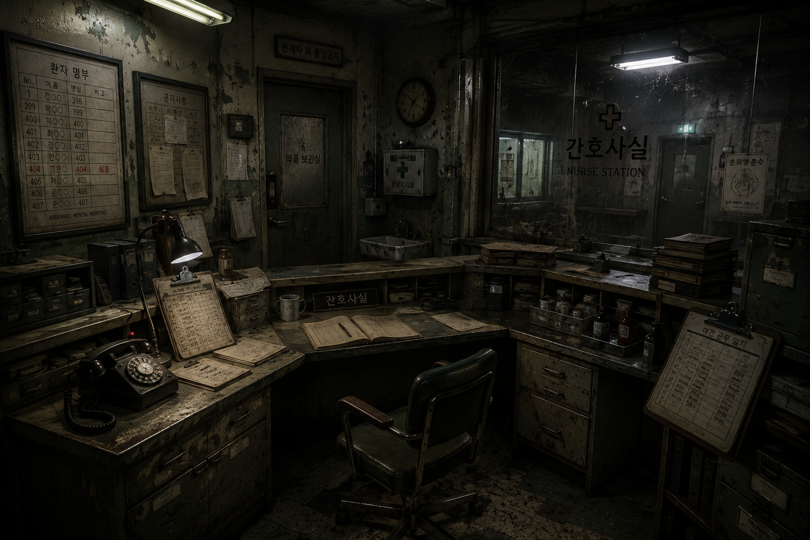

# THE WITNESS

> 기억의 조각을 모아, 사건의 진실을 밝혀라.

**Point & Click · 미스터리 · 방탈출 웹게임 · 웹 개발 부트캠프 4인 팀 프로젝트**

[GitHub 저장소](https://github.com/taenoll/EST-Project02) · [develop 소스](https://github.com/taenoll/EST-Project02/tree/develop)

> 문서 기준: 2026-10-28 확인한 최신 `develop` 커밋 [`af011bc`](https://github.com/taenoll/EST-Project02/commit/af011bc631756ce5639baba6e8107b8f0bf4e3dc). 기능 설명은 해당 소스를 기준으로 작성했습니다.


## 01. 프로젝트 소개

**THE WITNESS**는 기억을 잃은 주인공이 병원 안의 사물과 기록을 조사하며 탈출의 실마리를 찾는 웹게임입니다. HTML, CSS, Vanilla JavaScript로 화면, 게임 진행, 상태 저장을 구현했습니다.

단순히 정답을 입력하는 방탈출을 넘어, 플레이어가 직접 발견한 기록을 비교하고 흩어진 단서를 연결하도록 구성했습니다. 어두운 병원 배경, 대사, BGM과 효과음을 통해 미스터리 분위기를 전달합니다.

**핵심 플레이 흐름:** 탐색 → 조사 → 단서 수집 → 추리 → 퍼즐 해결 → 다음 챕터

- **탐색:** 화면 속 조사 버튼을 눌러 사물의 설명과 단서를 확인합니다.
- **수집:** 획득한 기록과 아이템을 인벤토리에서 다시 살펴봅니다.
- **추리:** 필요한 단서를 모아 잠긴 공간의 숫자 암호를 풉니다.
- **진행:** 병실에서 간호사실, 원장실로 이동하며 이야기를 따라갑니다.

| 항목 | 내용 |
| --- | --- |
| 프로젝트명 | THE WITNESS |
| 장르 | Point & Click 미스터리 방탈출 |
| 개발 인원 | 4명 |
| 프로젝트 형태 | 웹 개발 부트캠프 팀 프로젝트 |
| 실행 환경 | ES Modules와 LocalStorage를 지원하는 웹 브라우저 |
| 배포 URL | https://taenoll.github.io/EST-Project02/  |

## 02. 게임 스토리

눈을 뜬 곳은 **양지정신병원의 낯선 병실**. 주인공은 자신이 누구인지, 왜 이곳에 있는지 기억하지 못합니다.

잠긴 문, 오래된 기록, 누군가 남겨 둔 메모. 평범해 보이는 사물에도 의문이 남아 있습니다. 병실을 벗어나 간호사실과 원장실을 조사할수록, 병원의 기록과 잃어버린 기억 사이의 연결이 조금씩 드러납니다.

이곳에 머물러서는 안 됩니다. 주변을 조사하고 단서를 모아, 숨겨진 진실과 탈출의 길을 찾아야 합니다.

## 03. 기술 스택

| 기술 | 사용 목적 |
| --- | --- |
| HTML5 | 진입 페이지, 게임 화면과 입력 폼의 마크업 |
| CSS3 | 배경, 모달, 인벤토리, 화면별 스타일과 전환 효과. Flexbox, 미디어 쿼리, `clamp()` 등 사용 |
| Vanilla JavaScript | DOM 조작, 클릭 이벤트, 조사·대사·퍼즐·아이템 처리 |
| ES Modules | `import` / `export`로 데이터, 게임 로직, 화면 코드를 분리 |
| Web Storage API | LocalStorage에 게임 진행 상황과 데모 회원 정보 저장 |
| HTML Audio API | `Audio` 객체로 BGM, 효과음, 프롤로그 음성 재생 |
| Google Fonts | Cinzel, Noto Serif KR 웹폰트 로드 |

별도의 프레임워크나 빌드 도구 없이 동작하는 정적 웹 프로젝트입니다.

## 04. 주요 기능과 구현 방식

### 오브젝트 조사 및 상태 관리 — `investigation.js`

[`js/game/investigation.js`](./js/game/investigation.js)의 `investigate(objectId)`가 `objects.js`에서 조사 대상의 데이터를 찾습니다. 처음 조사한 대상은 `gameState.checkedObjects`에 ID를 기록하고 자동 저장합니다.

반환값에는 설명·연결 아이템과 함께 `alreadyChecked`가 포함됩니다. 각 챕터는 이 값을 이용해 최초 조사 시 보상을 지급하거나, 조사한 버튼을 흐리게 표시합니다. CH1과 CH2에서는 특정 단서를 확보해야 퍼즐 조사 버튼이 나타납니다.

`objects.js`는 조사 문구와 연결 아이템 ID를, `items.js`는 아이템 이름·이미지·설명을 정의합니다. `scenes/chapter*.js`가 이 데이터와 공통 기능을 연결하고, `dom` 모듈이 인벤토리·모달 등 화면을 갱신합니다.

### 대사 출력과 진행 — `dialogue.js`

[`js/game/dialogue.js`](./js/game/dialogue.js)의 `initDialogue(dialogueData, onComplete)`가 대사창을 만들고 이름과 문장을 순서대로 출력합니다.

- 대사창을 클릭하면 다음 문장으로 넘어갑니다.
- 문장 전환에 250ms 페이드 효과를 적용하고, 전환 중 중복 클릭을 막습니다.
- 마지막 문장 이후 창을 숨기고, 전달받은 완료 함수를 실행합니다. CH1에서는 조사 대사가 끝난 뒤 퍼즐을 여는 데 사용합니다.

### 아이템 획득과 관리 — `inventory.js`

[`js/game/inventory.js`](./js/game/inventory.js)는 아이템 ID를 기준으로 보유 여부와 획득을 처리합니다.

| 함수 | 역할 |
| --- | --- |
| `hasItem()` / `getItem()` | 보유 여부 확인 / 아이템 데이터 조회 |
| `addItem()` / `addMultipleItems()` | 유효한 아이템을 중복 없이 추가하고 저장 |
| `openItem()` | 아이템 이미지, 이름, 설명을 공통 모달로 표시 |
| `clearChapterItems()` | `important: true`인 아이템만 남기고 목록 갱신·저장 |

아이템 정보는 `data/items.js`, 실제 목록 출력은 `dom/renderInventory.js`가 담당합니다. 데이터 변경과 화면 출력을 나누어, 획득 후 `renderInventory()`로 화면을 갱신합니다. 인벤토리의 위·아래 버튼으로 목록을 이동할 수 있습니다.

### 공통 모달 및 챕터 전환 — `renderModal.js`

[`js/dom/renderModal.js`](./js/dom/renderModal.js)의 `openModal()`과 `closeModal()`은 아이템 상세, 힌트, 메뉴, 퍼즐에서 사용하는 팝업의 공통 틀을 제공합니다.

챕터 전환은 `nextChapterModal()`로 별도의 확인 화면을 표시합니다. 이동 버튼을 누르면 중복 클릭을 막고 문 효과음을 재생한 뒤, 전달받은 함수를 실행합니다. 각 전환 함수에서 다음 장면 출력과 진행 상태 저장을 처리합니다.

```text
조사 버튼 클릭
  → objects.js에서 대상 조회
  → 조사 기록 저장
  → 대사 출력 / 아이템 획득
  → 인벤토리 갱신
  → 단서 조건에 따라 퍼즐 공개
  → 퍼즐 정답 확인 및 보상
  → 이동 확인 모달을 통해 다음 챕터 진행
```

## 05. 추가 기능

| 기능 | 구현 내용 |
| --- | --- |
| 숫자 퍼즐 | 세 자리 다이얼을 위·아래 버튼으로 조작합니다. 정답이면 아이템 또는 후속 동작을 실행하고, 오답이면 숫자를 초기화합니다. |
| 단계별 힌트 | 챕터별 레벨 1~3 힌트를 선택합니다. 사용한 가장 높은 단계를 `hintLevel`에 저장합니다. |
| 자동 저장·이어하기 | 조사, 아이템 획득, 힌트 사용, 챕터 이동 등에서 `gameState`를 JSON으로 저장합니다. 타이틀의 이어하기는 저장된 장면에 따라 CH1~CH3을 다시 출력합니다. |
| 새 게임 | 기존 진행 데이터를 초기화하고 프롤로그부터 시작합니다. |
| 게임 메뉴 | 계속하기, 챕터 다시 시작, 타이틀로 돌아가기, BGM·효과음 ON/OFF를 제공합니다. |
| 로그인·회원가입 | 아이디·이메일 중복, 필수 입력, 비밀번호 규칙을 검사합니다. 로그인 후 닉네임 표시와 로그인 상태 유지를 지원합니다. |
| 사운드 연출 | 반복 BGM, 챕터 이동 시 문 효과음, 프롤로그의 진행에 맞춘 음성을 재생합니다. 문 효과음은 미리 불러와 재사용합니다. |
| 스토리 화면 | 프롤로그와 엔딩 서사를 스크롤해 읽습니다. 끝까지 읽으면 다음 버튼을 표시하며, 스크롤이 필요 없는 화면도 처리합니다. |

**저장과 회원 기능의 범위**

- 로그인 없이도 게임을 시작할 수 있습니다.
- 회원 기능은 **브라우저 내부의 학습용 데모**입니다. 서버 인증 없이 비밀번호를 포함한 회원 정보를 LocalStorage에 저장하므로 실제 비밀번호나 개인정보를 입력하지 마세요.
- 진행 데이터는 브라우저의 `gameState` 키 하나를 사용하며, 회원별로 분리되지 않습니다. 같은 브라우저·접속 주소에서 이용해야 기존 저장 데이터를 사용할 수 있습니다.
- 새 게임과 로그아웃은 진행 데이터를 초기화합니다. 브라우저의 사이트 데이터를 삭제해도 저장 내용이 사라집니다.
- 이어하기는 CH1~CH3을 대상으로 구현되어 있습니다. 프롤로그·엔딩의 읽던 위치를 복원하지는 않습니다.

## 06. 게임 구성

| 순서 | 장면 | 플레이 내용 |
| --- | --- | --- |
| 시작 | 프롤로그 | 기억을 잃고 병실에서 깨어난 상황을 확인합니다. |
| CH1 | 낯선 병실 | 사물과 기록을 조사하고 단서를 연결해 첫 잠금을 풉니다. |
| CH2 | 간호사실 | 근무 일지, 약품 자료, 전화 기록을 비교하며 다음 공간의 실마리를 찾습니다. |
| CH3 | 원장실 | 병원에 남겨진 문서와 사진을 조사하고 마지막 공간으로 향합니다. |
| 마무리 | 엔딩 프롤로그 | 흩어진 기록이 이어지는 마지막 서사를 스크롤로 읽습니다. |
| 종료 | 엔딩 | 이야기를 마무리하고, 처음으로 돌아가기 버튼으로 진행을 초기화한 뒤 타이틀로 이동합니다. |

## 07. 프로젝트 폴더 구조

```text
EST-Project02/
├── index.html                 # 게임 진입 HTML, 화면·모달 컨테이너
├── main.js                    # 공통 이벤트 연결, 타이틀 출력, 저장 데이터 로드
├── assets/
│   ├── images/
│   │   ├── backgrounds/       # 타이틀·챕터·전환·엔딩 배경
│   │   ├── characters/        # 대사창 캐릭터 이미지
│   │   ├── icons/             # 조사 아이콘, 파비콘
│   │   └── items/             # 기록·사진·카드 등 아이템 이미지
│   └── audio/
│       ├── bgm/               # 배경 음악
│       └── sfx/               # 문 효과음, 프롤로그 음성
├── css/                       # 공통·게임·챕터·인증·시작/종료 화면 스타일
├── js/
│   ├── data/                  # objects.js, items.js, puzzles.js(힌트 데이터)
│   ├── dom/                   # 모달·인벤토리·힌트 출력, 정답 판정, 공통 이벤트
│   ├── game/                  # 조사·대사·아이템·퍼즐·힌트·메뉴·오디오 로직
│   ├── scenes/                # 타이틀·프롤로그·CH1~3·엔딩·인증 화면
│   └── state/                 # 공유 gameState, 게임 저장·복원, 데모 회원 관리
├── lib/
│   └── dom/                   # getNode.js 등 DOM 유틸리티
└── README.md
```

## 08. 실행 방법

저장소에 `package.json`과 npm 실행 스크립트가 없습니다. 패키지 설치나 빌드 없이 **프로젝트 루트를 정적 웹 서버로 열어** 실행합니다. `type="module"`을 사용하므로 HTML 파일을 더블 클릭하는 `file://` 방식 대신 HTTP로 접속하세요.

### VS Code Live Server 사용

1. VS Code에서 `EST-Project02` 폴더를 엽니다.
2. Live Server 확장이 없다면 설치합니다.
3. 루트의 `index.html`을 우클릭하고 **Open with Live Server**를 선택합니다.
4. 열린 브라우저에서 **게임 시작**을 누릅니다.

### Python이 설치되어 있는 경우

프로젝트 루트에서 다음 명령으로 정적 서버를 실행할 수도 있습니다.

```powershell
python -m http.server 8000
```

브라우저에서 `http://localhost:8000`에 접속합니다. 서버 종료는 터미널에서 `Ctrl+C`를 누릅니다.

게임 화면의 조사 버튼과 대사창은 클릭으로 조작합니다. Google Fonts를 불러오려면 인터넷 연결이 필요합니다. 브라우저의 오디오 재생 정책에 맞춰 BGM은 게임 시작·이어하기 클릭 시 재생을 시도합니다.

## 09. 팀원 및 역할

4인 팀 프로젝트입니다. 아래 기여 내용은 `develop`에 병합된 PR과 커밋에서 확인한 범위이며, 공동 수정이 포함됩니다. 실명과 최종 역할 명칭은 팀 확인 후 추가합니다.

| 팀원 이름 | GitHub | 확인된 기여 | 근거 |
| --- | --- | --- | --- |
| [팀원 이름 추가 예정] | [taenoll](https://github.com/taenoll) | CH1, 조사·공통 모달·메뉴, BGM·효과음 및 프롤로그 더빙 연동 | [#7](https://github.com/taenoll/EST-Project02/pull/7), [#8](https://github.com/taenoll/EST-Project02/pull/8), [#66](https://github.com/taenoll/EST-Project02/pull/66), [#69](https://github.com/taenoll/EST-Project02/pull/69) |
| [팀원 이름 추가 예정] | [dusml](https://github.com/dusml) | 인벤토리, 저장·이어하기, 타이틀·프롤로그·엔딩 UI, 로그인·회원가입 데모 | [#13](https://github.com/taenoll/EST-Project02/pull/13), [#30](https://github.com/taenoll/EST-Project02/pull/30), [#61](https://github.com/taenoll/EST-Project02/pull/61), [#67](https://github.com/taenoll/EST-Project02/pull/67) |
| [팀원 이름 추가 예정] | [becca202420](https://github.com/becca202420) | CH2와 아이템 연동, 힌트·퍼즐 공통 함수 | [#12](https://github.com/taenoll/EST-Project02/pull/12), [#63](https://github.com/taenoll/EST-Project02/pull/63), [커밋 3de7fd5](https://github.com/taenoll/EST-Project02/commit/3de7fd5) |
| [팀원 이름 추가 예정] | [gksd222-dev](https://github.com/gksd222-dev) | 대화창, CH3, 챕터 전환 함수와 엔딩 연결 | [#5](https://github.com/taenoll/EST-Project02/pull/5), [#52](https://github.com/taenoll/EST-Project02/pull/52), [#65](https://github.com/taenoll/EST-Project02/pull/65), [#70](https://github.com/taenoll/EST-Project02/pull/70) |

## 10. 트러블슈팅 및 개선 경험

### PR 기록으로 확인한 개발 과정

PR의 작업 내용과 현재 소스를 함께 확인해 정리했습니다. 과거 PR에 적힌 임시 처리와 최종 코드가 다른 경우 현재 구현을 기준으로 설명합니다.

| 주제 | 문제 또는 개선 목적 | 반영한 방식 | 작업 기록 |
| --- | --- | --- | --- |
| 공통 기능 연결 | 여러 챕터에서 공통 게임 기능을 불러오는 구조 정리 | `game/index.js`에서 공통 함수를 다시 내보내고 챕터의 import 경로 정리 | [#16](https://github.com/taenoll/EST-Project02/pull/16) |
| 저장·복원 흐름 | 새 게임과 이어하기의 화면 연결 정리 | 프롤로그 종료 시 CH1 진입 상태를 저장하고, 이어하기에서 저장된 장면에 따라 챕터와 인벤토리 출력 | [#30](https://github.com/taenoll/EST-Project02/pull/30) |
| 반응형 UI | 화면 크기에 따른 스토리·대화창·모달 배치 보완 | 미디어 쿼리와 `clamp()`로 크기 조절, 프롤로그 진행 버튼을 스토리 창 밖으로 배치 | [#66](https://github.com/taenoll/EST-Project02/pull/66), [#67](https://github.com/taenoll/EST-Project02/pull/67) |
| 프롤로그 진행 | 스크롤이 없는 화면에서 진행 버튼과 두 번째 더빙이 처리되지 않는 문제 | 스크롤 필요 여부를 검사해 버튼 표시. 더빙은 스크롤 위치 또는 첫 음성의 `ended` 이벤트에 맞춰 재생하며 중복 재생 차단 | [#71](https://github.com/taenoll/EST-Project02/pull/71) |
| 오디오 타이밍 | 문 효과음 재생 지연과 화면 전환 시점 개선 | 문 효과음 사전 로딩·캐싱, 이동 버튼 중복 클릭 방지, 효과음 실행 후 900ms 뒤 전환 함수 호출 | [#69](https://github.com/taenoll/EST-Project02/pull/69) |

### 코드에서 확인한 안정화 방식

| 고려한 문제 | 코드에 반영된 방식 | 효과 |
| --- | --- | --- |
| 같은 사물을 반복 조사하며 기록·아이템이 중복될 수 있음 | `checkedObjects`, `alreadyChecked`, `hasItem()`으로 기존 상태 확인 | 조사 기록과 아이템의 중복 추가 방지 |
| 대사 전환 중 빠른 클릭으로 문장이 건너뛰어질 수 있음 | `isTransitioning`으로 전환 중 입력 차단 | 전환 효과가 끝난 뒤 다음 입력 처리 |
| 화면 전환 후 조사 표시가 사라질 수 있음 | 저장된 `checkedObjects`를 읽어 `is-checked` 클래스 재적용 | 조사 여부를 화면에 다시 표시 |
| 챕터마다 팝업을 따로 작성하면 UI가 달라질 수 있음 | 공통 모달 함수에 내용과 완료 함수를 전달 | 팝업 틀과 닫기·이동 동작 재사용 |
| 짧은 스토리는 스크롤 이벤트가 발생하지 않을 수 있음 | 내용 높이와 표시 영역 높이를 비교 | 스크롤 없이도 다음 버튼 표시 |
| 오디오 재생이 브라우저 정책 등으로 실패할 수 있음 | 사용자 클릭 시 BGM 재생, `play().catch()` 처리 | 재생 실패를 콘솔에 기록하고 처리 |

### 현재 구조에서의 개선 과제

- **저장 데이터 검증:** `gameLoad()`의 JSON 파싱 예외 처리와 데이터 구조 검증을 추가할 수 있습니다.
- **이어하기 일관성:** CH2·CH3은 화면을 생성할 때 `clearChapterItems()`를 호출합니다. 챕터 최초 진입과 저장 복원을 구분해 일반 아이템의 복원 및 잠금 해제 UI를 함께 점검할 필요가 있습니다.
- **챕터 재시작 범위:** 현재는 해당 챕터의 아이템·조사 기록·힌트 단계를 초기화합니다. 인트로와 퍼즐 등 다른 진행 정보의 초기화 기준도 통일할 수 있습니다.
- **이벤트 연결:** CH3의 힌트·인벤토리 이벤트를 화면 생성 시 한 번 연결하도록 정리해 중복 등록과 최초 클릭 동작을 개선할 수 있습니다.
- **실서비스 인증:** 회원별 저장과 실제 인증이 필요하다면 서버 인증 및 안전한 비밀번호 저장을 별도로 구현해야 합니다.

추가 회고: **[팀이 직접 확인한 테스트 결과·협업 경험·담당자 입력]**

## 11. 게임 미리보기 및 리소스 출처

### 실제 게임에 사용한 배경 이미지

아래 이미지는 저장소의 게임 배경 원본입니다. 대사창·조사 버튼·인벤토리가 합성된 플레이 스크린샷은 아닙니다.

| CH1 · 낯선 병실 | CH2 · 간호사실 |
| --- | --- |
|  |  |

**CH3 · 원장실**


- 실제 플레이 스크린샷 또는 GIF: **[팀 입력]** 촬영 후 파일 경로 추가
- 배포 URL: **[팀 입력]** 배포 후 주소 추가

### 리소스 출처

폰트는 `css/start-end.css`의 Google Fonts 불러오기 주소에서 사용을 확인했습니다. 이미지·음원의 제작자, 원본 링크, 이용 조건은 현재 저장소에서 확인되지 않아 입력란으로 남깁니다.

| 구분 | 사용 리소스 | 출처 및 이용 조건 |
| --- | --- | --- |
| 영문 폰트 | Cinzel | [Google Fonts](https://fonts.google.com/specimen/Cinzel) · 이용 조건: **[팀 확인 후 입력]** |
| 한글 폰트 | Noto Serif KR | [Google Fonts](https://fonts.google.com/specimen/Noto+Serif+KR) · 이용 조건: **[팀 확인 후 입력]** |
| 배경 이미지 | `assets/images/backgrounds/` | **[제작자·원본 URL·라이선스 입력]** |
| 캐릭터 이미지 | `assets/images/characters/player1.png` | **[제작자·원본 URL·라이선스 입력]** |
| 아이템 이미지 | `assets/images/items/` | **[제작자·원본 URL·라이선스 입력]** |
| 조사 아이콘·파비콘 | `assets/images/icons/` | **[제작자·원본 URL·라이선스 입력]** |
| BGM | `assets/audio/bgm/main-bgm.mp3` | **[제작자·원본 URL·라이선스 입력]** |
| 문 효과음 | `assets/audio/sfx/door-open.wav` | **[제작자·원본 URL·라이선스 입력]** |
| 프롤로그 음성 | `assets/audio/sfx/prolog-1.m4a`, `prolog-2.m4a` | **[제작·녹음자·이용 조건 입력]** |

### 라이선스

현재 저장소에 별도의 라이선스 파일은 없습니다. **[팀 협의 후 코드의 라이선스 및 리소스별 이용 조건 입력]**
